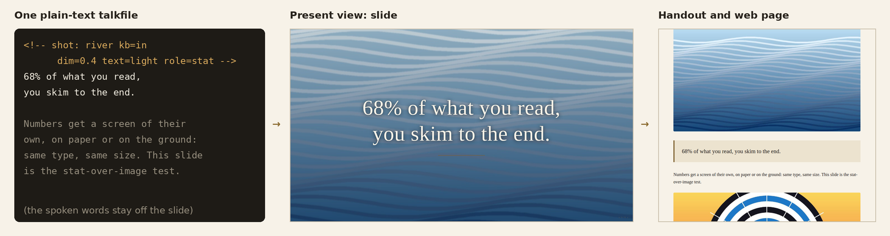
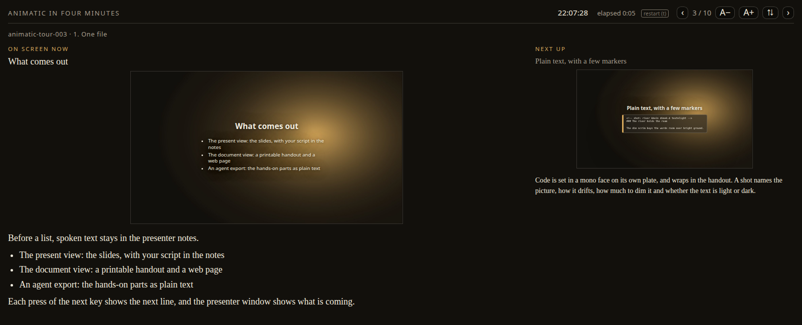

# Animatic

Write a talk as a script. Get slides, a handout, a web page and a plain-text agent brief from the same file.



**[Watch the four-minute tour](https://rkelln.github.io/animatic/)**: a deck written in Animatic, with its handout and web page.

Animatic is a talk-writing system for people who speak. You write one plain-text
file (a **talkfile**) that reads like a video-essay narration: the spoken words are
the default text, and a shot marker drops in wherever the picture changes. The same
file renders as:

- **Present view**: image-forward slides for the live talk, with the script in the speaker notes and a second presenter window (`s`).
- **Document view**: the spoken words as prose with the visuals embedded. Print it to a PDF handout or publish it as a scrolling web page.
- **Agent export**: the hands-on parts as a plain-text file a coding agent can follow.

The name is the *animatic*, the timed, moving pre-visual of a film.

## Why use it

- **Agents can work with it.** A talk is a text file with a small, checked grammar,
  not a binary deck built for a mouse. An agent can write it, edit it, run
  `animatic check` and read the findings, and the format spec is written to be
  followed by one. Keynote and PowerPoint are designed for people clicking.
- **Media is part of the format.** Pictures and video are named in the script and
  resolved from cards that record where each came from, its credit and licence, and
  how it was made. Checks flag a missing credit or licence on a deck marked public,
  and a card with no file behind it.
- **One source, many exports.** Slides, a printable handout, a web page and an agent
  brief come from the same file, so they cannot drift apart. Reveal.js and Marp are
  good at the slide; Animatic starts from the script and treats the slide as one view
  of it.
- **Deterministic.** Building twice gives identical bytes, so a diff of the output
  is a diff of your changes.

It was built for, and first used in, the Toronto Public Library's Applied AI
Innovator in Residence programme (2026), where the same talk had to work live, as a
printable handout, and as a web page for people who could not attend.

## Quick start

Requires Python 3.10 or newer. Python 3.12 is what it is developed on.

```sh
git clone https://github.com/RKelln/animatic.git && cd animatic
uv sync                      # or: python3 -m venv .venv && .venv/bin/pip install -e .
uv run animatic examples/tour/talk.md --out /tmp/demo
```

Then open `/tmp/demo/present/index.html` in a browser. Arrow keys page through the
slides; `s` opens the presenter window (below). `/tmp/demo/document/index.html` is the
handout view. Without uv, run the scripts directly with a Python that has
`pyyaml` and `pillow` installed: `python3 build.py examples/tour/talk.md --out /tmp/demo`.

Check that everything works on your machine:

```sh
uv run python tests/run.py   # the golden suite: 65 profiles, should end "failed: 0"
```

Optional tools, used only by the features that need them:

| Tool | Needed for |
|---|---|
| Chromium or Chrome | the handout PDF (`tools/handout-pdf.py`) and the browser tests |
| ffmpeg / ffprobe | video stills, timing from recordings, web-sized video |

Without them, builds still work; the affected feature says what is missing.

Developed and tested on Linux with Python 3.10 and 3.12. The builder is plain Python,
so it should run on macOS and Windows, but those are untested. `--watch` replacing an
older watcher uses `/proc`, so it is Linux only, and the handout tool has notes for
snap-packaged Chromium (see [docs/reference.md](docs/reference.md)).



## Your first talk

Save this as `talk.md`:

```markdown
---
slug: hello
title: "Hello, animatic"
theme: lecture
---

<!-- shot -->
# Hello, animatic

The spoken words go underneath every screen. They show up in the speaker notes
and in the handout, never on the slide.

---

## Movement 1 · The idea

### A heading above a shot stays off the slide but prints in the handout

<!-- shot: reveal -->
Spoken text before a list is not shown on the slide. It appears in the presenter
notes for you to read.

- Lists show on the slide
- Add `reveal` to the shot and they appear one at a time
- Each press of the next key shows the next item

Text after the list is spoken once it is all visible. A next mark in the script
where you will press the key [next] gives the presenter view a reminder at
that point [next] to show the next list item.

<!-- shot -->
> A quote can have a screen of its own.
~ Someone worth quoting

[Timer: 5:00]

This slide shows a five-minute timer.
```

```sh
uv run animatic check talk.md          # 0 fatal means the file is well formed
uv run animatic build talk.md          # render into out-<slug>/
uv run animatic build talk.md --watch  # rebuild on every save
```

`animatic` with no arguments lists its commands; `animatic pack` seals a folder you
can carry to a venue (see the Commands table).

Each `<!-- shot -->` starts a screen. A shot can name a picture
(`<!-- shot: river kb=in dim=0.4 text=light -->`), and the name is resolved from a
media card, a file in the deck's `media/` folder or a shared library.
`examples/tour/talk.md` is the tour deck; `examples/roles-demo/talk.md` exercises every screen role.
The full grammar is `docs/format-spec-v1.md`.

## Commands

| Command | What it does |
|---|---|
| `animatic build [DECK] [--out DIR]` | render present view, document view and the JSON sidecars into `out-<slug>/` (same as `python3 build.py`) |
| `animatic check [DECK ...] [--strict]` | the check suite; `--register` lists every check, `--json` gives findings as JSON |
| `animatic pack [DECK] [--out DIR] [--inert]` | a sealed, presentable copy: plain build + check + a hashed `BUILD.json`; `--verify` re-checks a copy on any machine, `--inert` leaves the waypoint publisher out |
| `animatic token [--show\|--check]` | store the waypoint publishing token (prompt, no echo, mode 0600) or report a fingerprint of the one in use |
| `animatic decks [--json]` | every deck the content roots hold, with the folder it builds into |
| `animatic serve [--port N]` | serve built decks on localhost, with video Range support |
| `python3 tools/handout-pdf.py <talkfile> <out.pdf>` | handout PDF (needs Chromium) |
| `python3 tools/web-export.py <talkfile> <out-dir>` | the document view as a self-contained web folder |
| `python3 tools/timing-report.py <talkfile>` | how long the talk runs, by movement and screen |
| `python3 tools/agent-export.py ...` | a plain-text file of the hands-on parts, for a coding agent |
| `python3 tools/serve-deck.py` | the deck server behind `animatic serve` |
| `python3 tests/run.py` | golden and property tests |

Builds are deterministic: running one twice gives identical bytes.

## Workshops with agents

If your audience works beside coding agents, waypoints tell those agents where the
room is. Mark a slide (`<!-- shot: waypoint=expanding -->`) and the deck publishes one
word when you reach it. A hook on each participant's machine can turn the word into a
fixed note for their agent, so someone who fell behind finds out without asking. Remote
text never reaches an agent, only a word from a list you wrote. The deck's half is in
this repo, and [examples/waypoint-service](examples/waypoint-service) is a working
example of the other two parts: a small service (standard library Python) and the hook
script. [docs/waypoints.md](docs/waypoints.md) gives the contract they must meet.

## For coding agents

Read `AGENTS.md` first (`CLAUDE.md` is a symlink to it) or `llms.txt`. The talkfile
format is the stable contract ([docs/format-spec-v1.md](docs/format-spec-v1.md)); the
code behind it is expected to change. `python3 check.py <talkfile> --strict` is the
quickest way to verify a talkfile you have edited, and `python3 tests/run.py`
verifies a code change.

## Documentation

| Doc | About |
|---|---|
| [docs/format-spec-v1.md](docs/format-spec-v1.md) | the talkfile grammar (normative) |
| [docs/reference.md](docs/reference.md) | build, handout PDF, web page, check and corpus-check commands |
| [docs/features.md](docs/features.md) | includes, quick select, waypoints |
| [docs/styling.md](docs/styling.md) | layers, tokens, themes, how to add one |
| [docs/media-pipeline.md](docs/media-pipeline.md) | media cards, generation log, style cascade |
| [docs/media-engines.md](docs/media-engines.md) | image and video generation engines |
| [docs/presenter-view.md](docs/presenter-view.md) | the second window and why it syncs over postMessage |
| [docs/live-capture.md](docs/live-capture.md) | `type: live` screens: a live window capture inside the deck |
| [docs/quick-select.md](docs/quick-select.md) | answering questions by jumping to a shelf slide |
| [docs/waypoints.md](docs/waypoints.md) | publishing "where the room is" for participants' agents |
| [tests/README.md](tests/README.md) | how the test suite is built |

## Layout

- `build.py`, `talkparse.py`, `mediaresolve.py`, `render.py`, `timing.py`: the builder. One talkfile in, four views out: present view (own-pager deck, script in the speaker notes), presenter view (`present/presenter.html`), document view (static HTML handout, print-to-PDF via print CSS), and `cues.json` (ordered cue id to script text and an estimated duration). Two sidecars are also written: `nav.json` (cue id to source line range, movement and kind) and `media-manifest.json` (the media resolution audit). Output goes to `out/` by default (gitignored).
- `check.py`: the deterministic check suite (`--register` prints all of them) with a fatal / warning / info / report taxonomy and `--strict`.
- `themes/`: CSS tokens and the two starter themes (`lecture`, `workshop`).
- `templates/`: a starter media card set (`cards.yaml`, `style.md`, `gen-log.md`).
- `tools/`: handout PDF, web export, agent export, timing report, deck server and other helpers.
- `examples/`: small specimens, not real talks.
- `tests/`: golden and property suites, and browser tests.
- `timing.yaml`: an optional file beside a talkfile with timing overrides (`animatic.timing.v1`), read and never written.
- `corpus.example.yaml`: template for `corpus.yaml`, the machine-local content roots the corpus check scans (`python3 build.py --corpus`). `corpus.yaml` is not tracked; with none, the check scans `examples/`.

## Status and roadmap

Format v1.0 draft. The grammar is meant to stay stable so that talks you write survive
rewrites of the code; the code is not. There is no compatibility burden yet, so
defects are removed rather than deprecated. Issues and pull requests are welcome, see
[CONTRIBUTING.md](CONTRIBUTING.md).

Not built yet, and different in kind from the slide and handout exports once the
basics settle:

- **Voice-over walkthrough**: step through the slides with recorded narration, an
  interactive version of a video essay.
- **Full video export**: render the whole talk to a video file. `cues.json` already
  carries each cue's script and estimated duration for it.

## Licence

MIT, see [LICENSE](LICENSE).
